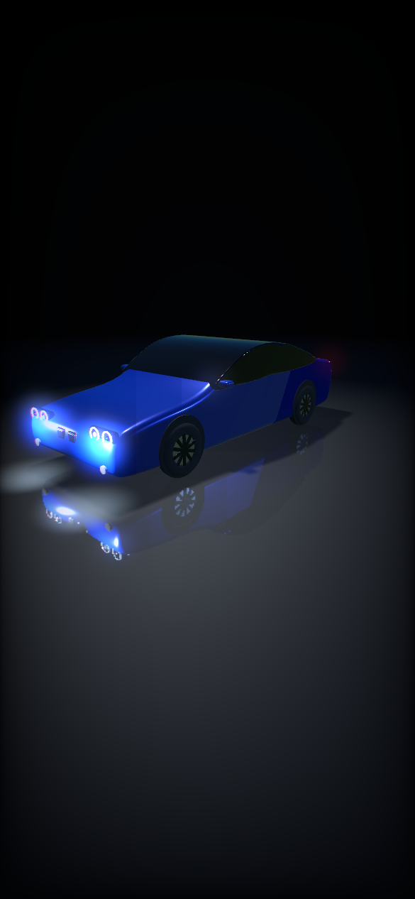
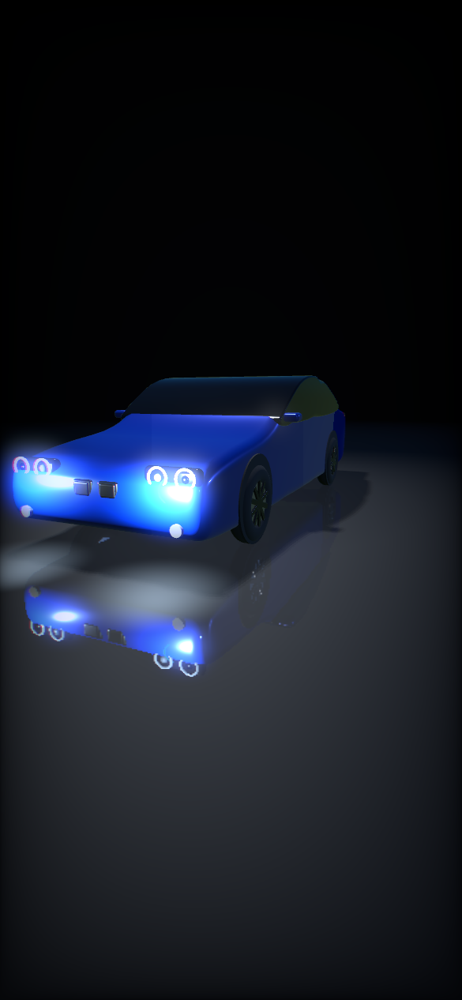
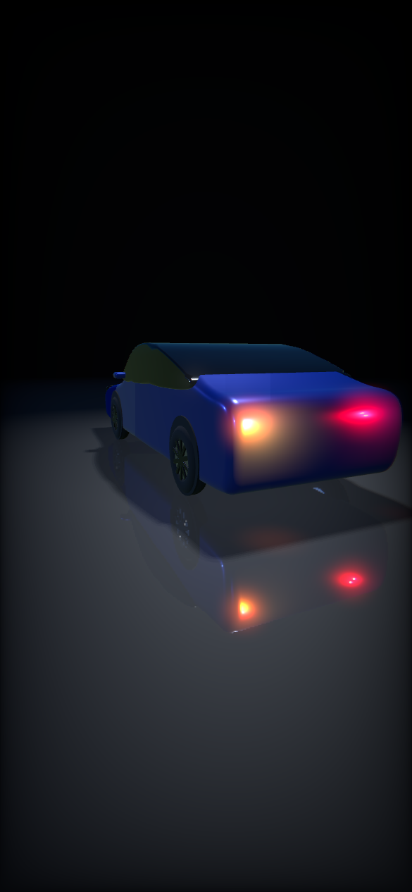

# LichtLab – Lichtsteuerung für BMW F36

iPhone-App (iOS 16.4+), die sich per Bluetooth LE mit einem **vLinker BM+** verbindet und einzelne Leuchten
über D-CAN per UDS (InputOutputControl, Dienst 0x2F) schaltet – mit einem 3D-Auto, auf dem du die Leuchten
direkt antippst.

| Übersicht | Front | Heck (OLED-Nachbau) |
|---|---|---|
|  |  |  |

*(Renderings der 3D-Szene vom Mac, ohne die Bedienoberfläche.)*

## Funktionen

- **3D-Auto (SceneKit):** Studio-Boden mit Spiegelung, HDR-Bloom, Vignette, kinoreife Kamerafahrten zwischen
  Übersicht, Front und Heck, langsamer Orbit, mit dem Finger drehbar.
- **Intro:** Kamera fliegt aus der Tiefenunschärfe heran, Titel blendet mit Blur ein und aus, die Lichter erwachen nacheinander.
- **Gezielte Auswahl:** Leuchten am Auto antippen (pulsierender Ring) oder über die Chips unten – dann
  „Einschalten“ / „Aus“. Der Power-Knopf schaltet alles aus und beendet die Diagnose-Sitzungen.
- **Szenen:** Welcome, Goodbye, Lauflicht, Scanner, Warnblinker, Wechselblinker, Puls – plus „OLED Welcome“ bei OLED-Rückleuchten.
- **Rückleuchten:** Original, LED-Nachrüstung (dynamischer Blinker) oder OLED-Nachbau (schmale Streifen,
  Lauflicht-Blinker). Für weitere Nachrüst-Leuchten kannst du eigene Einträge mit Position am Auto anlegen.
- **Vorschau-Modus:** Ohne Adapter läuft alles nur im 3D-Modell – zum Ausprobieren.
- **Lackfarben:** Saphirschwarz, Alpinweiß, Estorilblau, Mineralgrau, Melbourne Rot, Glaciersilber.
- **Fehlerspeicher (Tab „Fehler“):** liest die Fehler aller Steuergeräte aus – nur lesen, nichts wird gelöscht.
  Schnell-Scan (bekannte F-Serien-Adressen) oder Vollscan (alle Adressen 01–7F), dazu die genormten
  OBD-II-Codes (P0300 …), Fahrgestellnummer und ein Bericht zum Teilen. Mit „Beispiel ansehen“ auch ohne Auto.
- **Diagnose-Konsole:** freie AT-/UDS-Befehle, Log teilen.

## Installation mit TrollStore

1. Auf GitHub ein neues Repository anlegen (darf privat sein) und **den ganzen Inhalt dieses Ordners** hochladen
   – inklusive des versteckten Ordners `.github`.
2. Im Repository auf **Actions** → „IPA für TrollStore bauen“. Der Build startet bei jedem Push auf `main`,
   oder manuell über *Run workflow*. Dauer ca. 5 Minuten.
3. Wenn der Lauf grün ist, liegt die neueste IPA immer hier:
   https://github.com/vapezzy/LichtLabb/releases/latest/download/LichtLab.ipa
4. Den Link auf dem iPhone in Safari öffnen → Datei laden → *Teilen* → **TrollStore** → Installieren.

Keine Apple-ID, kein 7-Tage-Ablauf.

## Erste Schritte am Auto

1. Zündung an (Start/Stopp-Knopf ohne Bremse), vLinker einstecken.
2. Oben rechts auf **Vorschau** tippen → „Adapter suchen“ → vLinker wählen. Der Status wechselt auf **Live**.
3. Zahnrad → *Diagnose-Konsole* → „Fahrgestellnr.“. Kommt `62 F1 90 …` mit deiner FIN zurück, steht die
   Verbindung zum FRM (Adresse 72).
4. Log über das Teilen-Symbol exportieren und an Claude schicken – damit geht's an die Licht-DIDs.

## Noch offen

- **Die DIDs für die einzelnen Leuchten sind unbekannt.** Bis sie eingetragen sind (Zahnrad → Leuchten
  einrichten), zeigen die Chips ein Schraubenschlüssel-Symbol und schalten nur die Vorschau.
- Geprüft wurde: Kompilieren gegen das macOS-SDK, der Antwort-Parser und die 3D-Szene (gerendert am Mac).
  Der iOS-Build selbst läuft erst in GitHub Actions; am echten Auto ist noch nichts getestet.

## Aufbau

| Datei | Inhalt |
|---|---|
| `RootView.swift` | Hauptbildschirm: 3D-Auto, Glas-Panels, Intro, Szenen |
| `CarScene.swift` | SceneKit-Szene: Karosserie, Leuchten, Kamera, Licht-Animationen |
| `CarSceneView.swift` | SCNView mit Antippen und Drehen |
| `LightController.swift` | Auswahl, Schalten, Szenen-Ablauf, Vorschau vs. Live |
| `LightShow.swift` | Szenen-Definitionen |
| `LightPreset.swift` | Leuchten, Positionen, Rückleuchten-Typ, Lackfarben |
| `SettingsView.swift` | Einstellungen und Leuchten-Editor |
| `BLEManager.swift` | Bluetooth-Verbindung zum Adapter (vLinker: Service 18F0) |
| `ELMSession.swift` | ELM327-Befehle, BMW-Adressierung, UDS, Sitzungen |
| `ConsoleView.swift`, `ConnectionView.swift` | Konsole und Adapter-Verbindung |
| `.github/workflows/build-ipa.yml` | Baut die unsignierte IPA für TrollStore |

## Sicherheit

- Nur im Stand. Lichtsteuerung über Diagnose ist im Straßenverkehr nicht zulässig.
- Xenon-Abblendlicht und Fernlicht kommen absichtlich in keiner Szene vor – Brenner nicht schnell takten.
- Die App schreibt nichts dauerhaft: `2F … 03` ist nur eine kurzzeitige Übersteuerung. Power-Knopf bzw.
  Zündung aus gibt die Kontrolle ans Steuergerät zurück.
- Keine Codier- oder Flash-Befehle (2E, 31, 34 …) in die Konsole tippen, wenn du nicht genau weißt, was sie tun.
